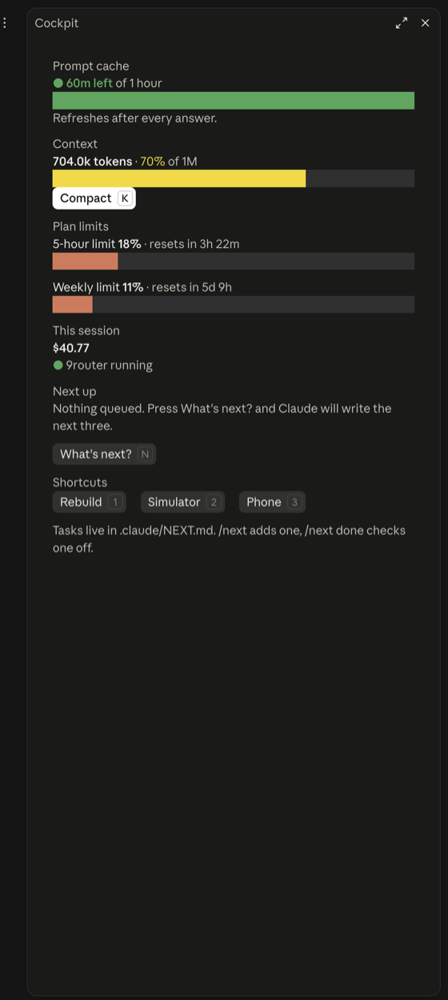

# claude-code-cockpit

A one-line band above the Claude Code prompt, a roomy **Cockpit panel** beside the conversation, and seven community mods, installed as one plugin. The band shows only what you glance at. The panel has everything else: prompt-cache countdown, context, plan limits with their reset times, session cost, your next tasks and project shortcuts. Everything that spends tokens or redraws your screen starts **off**.

```text
 ◔ 42m   ctx 72.5k   Next  Write docs/specs/PLAN-2.md for the phase 2 slices        Continue   Details
```

The band is drawn with Claude's own text and buttons, so it takes the app's fonts and theme, truncates the task by itself, and cannot flash or resize. **Details** (or `/cockpit`) opens the panel as a tab in the right-hand side panel.

<p align="center">
  
</p>

<p align="center">
  
</p>

These are screenshots of the real desktop app, showing the dark theme.

## What is inside

| Plugin | What it does | Default here | Origin |
|---|---|---|---|
| **cockpit** | The band, the Cockpit panel, next-task list, Continue / What's next / Compact buttons, guards, and a cheat-sheet skill | on | this repo (MIT) |
| cache-tax | Shows the rewrite price before a cold send; opt-in keep-warm for the prompt cache | warns, never drops; keep-warm **off** | [karanb192/cache-tax](https://github.com/karanb192/cache-tax) |
| claude-reflect (`reflect-mod`) | Notices corrections and offers to save them as rules in `CLAUDE.md` | **paused** | [BayramAnnakov/claude-reflect](https://github.com/BayramAnnakov/claude-reflect) |
| skins | Redraws the transcript: tool rows, diff cards, table and code cards, spinner | **off**, its own band off | [hellosverre/claude-skins](https://github.com/hellosverre/claude-skins) |
| filetree | IDE-style file tree in the sidebar with git status and read/write activity | opens with `/filetree` (does not dock by itself) | [data-goblin/claude-code-filetree](https://github.com/data-goblin/claude-code-filetree) |
| replay-theater | Step through the last turn's file edits, one diff at a time | on | [anthropics/claude-code-playground](https://github.com/anthropics/claude-code-playground) |
| blast-radius | Holds `rm -r`, `git reset --hard`, `git clean`, force push and migrations until you press Proceed | on | [anthropics/claude-code-playground](https://github.com/anthropics/claude-code-playground) |
| savvy-progress | Progress bar and agents panel for flows and subagents | idle until something reports | [JohnnyVizz/claude-kit](https://github.com/JohnnyVizz/claude-kit) |

The seven community mods are vendored here at pinned commits, with small patches (listed in each folder's `SOURCE.md`) so they start quiet and stack above each other instead of replacing each other's band. Their original licences are kept.

## Install

Needs Claude Code 2.1.287 or later.

```text
/plugin marketplace add cGradying/claude-code-cockpit
/plugin install cockpit@janvin-mods
```

or from a terminal:

```bash
claude plugin marketplace add cGradying/claude-code-cockpit
claude plugin install cockpit@janvin-mods --scope user
```

`cockpit` lists the seven mods as dependencies, so installing it installs them all. If a dependency does not install by itself, install it by name, for example `claude plugin install skins@janvin-mods`. Then restart Claude Code (or the desktop app) and open a new session.

To remove everything: `/plugin`, pick `cockpit`, uninstall, and do the same for each mod you no longer want. Each one is independent.

## A quick tour

**The band.** One line above the prompt: the cache countdown (`◔ 42m`, green, then amber, then red), context, and the next task. The 5-hour and weekly limits join the line only once they pass 60%, and `9router down` shows only if it was up and stopped. Buttons sit at the right; click them, or focus the band (`ctrl+x` then `tab`) and press the key.

| Button | Key | Does |
|---|---|---|
| Continue | `c` | Sends "continue with the next task" for the first open line of `.claude/NEXT.md`, and asks Claude to check it off when done. Hidden while a turn runs. |
| Details | `d` | Opens the Cockpit panel. |
| Compact | `k` | Appears past 70% context. Runs `/compact` and tells it to keep the plan, open tasks, PRs, decisions and open bugs. |

**The Cockpit panel.** One tab in the side panel with room for each number: prompt cache (time left, a bar, what happens if it lapses), context (tokens, percent, window size, Compact), plan limits (each with a bar and when it resets), this session (cost, 9router), your next five tasks (Continue, What's next?), and your project shortcuts. Bars are solid boxes sized in percent and follow the app's light or dark theme. Open it with **Details** or `/cockpit`.

**Guards that run quietly.** A shell command carrying a Claude or Anthropic co-author line is refused. A prompt containing a pasted API key is held once (press Enter again to send it anyway). Prompts about UI or design get a hidden nudge toward the `impeccable` skill if you have it.

**Commands.** `/cockpit`, `/next`, `/keepwarm`, `/cache-tax`, `/reflect-pause`, `/reflect-queue`, `/skin`, `/filetree`, `/replay`, `/agents-info`. Details in [docs/COMMANDS.md](docs/COMMANDS.md); inside Claude Code, the `cockpit:help` skill prints the same cheat sheet.

## Quiet by default

Three things in the bundle can cost tokens or change your screen, so they start off:

- **Keep-warm** (cache-tax) sends a real model request about every 50 minutes while armed. It is off; you arm it with `/keepwarm`. The cold-send guard only *warns* by default: it shows the rewrite price and still sends your message.
- **Correction checking** (claude-reflect) sends short prompts to Haiku. It starts paused; `/reflect-pause` turns it on. `remember: <rule>` works either way and needs no model.
- **Skins** redraw the whole transcript. It starts off; `/skin noir` turns it on.

How to change each: [docs/CONFIGURATION.md](docs/CONFIGURATION.md).

## Documentation

- [docs/COMMANDS.md](docs/COMMANDS.md): every command, button, key and guard.
- [docs/CONFIGURATION.md](docs/CONFIGURATION.md): settings, `NEXT.md`, `quick.json`.
- [docs/ARCHITECTURE.md](docs/ARCHITECTURE.md): why it is eight plugins, how the band is built, and the rules that shaped it.
- [docs/SECURITY-AUDIT.md](docs/SECURITY-AUDIT.md): what each mod runs, reads and writes, as read before shipping.
- [docs/DEVELOPING.md](docs/DEVELOPING.md): validating, testing, and updating the vendored mods.
- [THIRD_PARTY_NOTICES.md](THIRD_PARTY_NOTICES.md): upstream sources, commits and licences.
- [CHANGELOG.md](CHANGELOG.md), [CONTRIBUTING.md](CONTRIBUTING.md), [SECURITY.md](SECURITY.md).

## Status and limits

- Written for Claude Code's mods feature, which is early access and may change between releases.
- The band and panel were built by looking at the real desktop app, and are tested with Claude Code's plugin test kit on the terminal and desktop surfaces. They have been run in the desktop app's Code tab; the terminal layout is covered by tests but has had less eyes on it. Please open an issue with a screenshot if something looks wrong.
- The file tree opens with `/filetree` (set `autoOpen` to `on` to dock it at session start). It needs a wide window, and upstream says it does not load in WSL sessions of the desktop app.
- Cache timings assume the one-hour prompt cache. With a five-minute cache the countdown will be wrong.

## Credits and licences

The code in `cockpit/` is MIT, Copyright (c) 2026 cGradying (see [LICENSE](LICENSE)). Each vendored mod keeps its own licence file and authorship: the two Anthropic mods are Apache-2.0, the rest are MIT. See [THIRD_PARTY_NOTICES.md](THIRD_PARTY_NOTICES.md). Thanks to the authors of all seven.
